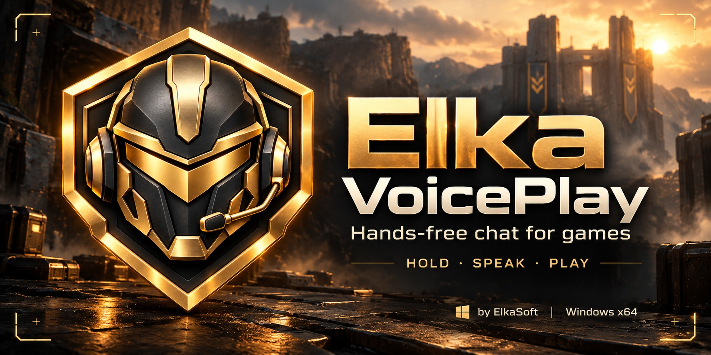

# Elka VoicePlay

**Hands-free chat for games**

Hold a button, speak, and let VoicePlay type into your game's chat. Each game can have its own talk button, chat keys and timing. VoicePlay also turns microphone and speaker audio into timestamped transcripts, with optional speaker labels and English translation.

Windows 11 · x64 · local processing · by ElkaSoft

## Download and install

Download **ElkaVoicePlay-0.7.0-setup-win-x64.exe** from the [latest preview release](https://github.com/torment78/ElkaVoicePlay/releases/tag/v0.7.0-preview.1).

1. Run the dark installer and choose where to install. The default is `Program Files/ElkaSoft/Elka VoicePlay`.
2. Leave **Create a desktop shortcut** selected to get the new gold icon. A Start-menu shortcut is created as well.
3. Open VoicePlay, choose your microphone and language, select a game profile, then **Apply settings**.
4. Focus the game, hold the talk button, speak and release it. VoicePlay checks the destination when it is ready to send.

The installer includes the game application and **Whisper Base**. Game chat works immediately without downloading transcription, NVIDIA software, Python, a paid API or an account. This is an **unsigned preview**; Windows may display an unfamiliar-publisher warning.

Prefer a portable folder? Download **ElkaVoicePlay-0.7.0-win-x64-game.zip**, extract the entire ZIP, and run **ElkaVoicePlay.exe**. Keep the included files and Models folder together. Send testers the installer or the complete ZIP, not your settings folder.

## Add transcription when you need it

Click **Transcribe audio**. The first time, this tab shows **Download** and the package size. Click it to download the transcription component from this same GitHub repository. VoicePlay checks the files, installs them, and opens the transcription controls automatically. No restart or manual file placement is required.

This optional component includes multi-input microphone/loopback transcription, timestamped TXT files, English translation and the standard speaker model (Classic). It shares the Base speech model already included in the game app. It does not duplicate Base or include the larger optional models.

Until you download this component, its worker and speaker-model binaries are absent from the game package. Game chat, profile selection and its own model choice work independently. A cancelled or failed download can be retried from the same tab; game chat remains available.

## Optional models and the full setup

Open **Downloads** in the app. Choose individual components or **Install all extras** for the full setup:

| Optional component | Download | Purpose |
|---|---:|---|
| Transcribe audio | 85.9 MB | Multi-input transcription and standard speaker labels |
| Whisper Medium | 1.53 GB | Middle-size alternative for game chat or transcription |
| Whisper Large-v3 | 3.10 GB | Larger speech model for game chat or transcription |
| Nemotron-3 speakers | 106 MB | Alternative speaker identification, up to eight voices per input |
| NVIDIA GPU support | 647 MB | GPU processing for transcription and Nemotron on compatible GPUs |

Downloads come from versioned releases in this repository. Existing model packs remain pinned to their original release; the new transcription component is versioned with this app. VoicePlay checks sizes and SHA-256 checksums, joins Large-v3's two parts, and installs everything in the correct place. Progress, cancellation and retry are built in. Completed parts are reused after an interrupted download. Allow additional temporary disk space during installation.

After downloading speech models, select them under **Game speech model** or **Transcribe audio → Models & speakers**. Each mode keeps its own selection; downloading does not change your chosen model. Game recognition uses CPU. Transcription's Automatic processing uses CPU until NVIDIA support and a compatible GPU/driver are available. The NVIDIA pack requires a CUDA 13-capable driver and does not install or change drivers.

The game installer plus **Install all extras** is the full version. Individual component assets on the release page are for the download manager; use the app to install them.

## Game profiles

Choose **New** or **Edit / Learn**. Profile name and hold-to-talk stay at the top; **Cancel** and **Save profile** stay at the bottom. Click a card to open its settings:

- **Game & automatic selection:** optional EXE link and process selection.
- **Chat sequence:** open chat, type, send, then optionally close chat.
- **Chat timings:** opening, typing and sending delays, plus button press duration.
- **Chat-switch command:** double-tap the talk button, or use a separate learned button, to send up to three keys.
- **Input & keyboard protection:** text insertion and optional keyboard blocking while sending.

Learn supports physical keyboard keys and the five standard mouse buttons. Press and release the chosen button. Escape cancels learning; choose Escape directly from the list if needed. Device-specific buttons can be mapped to keyboard keys in the device's own software.

For War Dogs, Enter opens chat and Enter sends it and returns to the game. The default open delay is 250 ms, character delay 10 ms and before-send delay 150 ms. Change these per profile. Disable automatic sending to review the inserted text yourself.

The **Game speech model** selector is global, not part of a profile. Choose Base, Medium or Large-v3, then **Load**. If a model is missing, the button opens Downloads; install it, return to Game profiles and load it. Game models run on CPU, and larger ones take more memory and processing time. Browse still supports a custom local ggml model. Changing the game model does not change the Transcribe audio model.

The optional chat-switch example is **Enter → Tab → Enter**. It changes the chat destination only in games that use those keys. It does not change profiles. In double-tap mode, hold beyond the adjustable window before speaking; a separate command button keeps hold-to-talk immediate.

Automatic EXE links are optional. Target checks happen when text or a command is ready to send; there is no idle foreground polling. Background games do not receive input. No valid destination means a warning and no delivery. Focus changes stop remaining steps, with no automatic retry.

Keyboard protection filters physical keys only during chat delivery. The mouse remains available. Escape cancels; a 15-second watchdog restores input if sending stalls. Already-held key releases pass through. Keys blocked during sending are discarded. Keep the game focused until delivery finishes.

## Transcribe audio

Switch to **Transcribe audio** in the same window; download its component first if prompted. Game talk buttons are paused on this tab.

1. Expand **Audio inputs**. Enable up to three inputs, choose devices and give them names. Microphone inputs include virtual recording endpoints. Speaker / loopback inputs capture what plays through the selected headphones or speakers. Disabled inputs are not captured.
2. Expand **Language & translation** to choose the input language and either the same language or English output.
3. Expand **Models & speakers** to choose transcription and speaker models independently. Speaker labels are optional and are estimates, not real names.
4. Expand **Transcript files** to choose combined or separate TXT files and their folder.
5. Click **Start transcription**. **Stop & save** finishes captured audio and saves the remaining lines. The buttons stay visible at the bottom.

Each session creates its own folder. Finished lines appear after speech pauses; continuous speech can take up to 30 seconds plus processing. Lines include elapsed timestamps, source names and optional speaker labels. Combined output is chronological. Timing is approximate, not frame-exact video timecode. Similar voices, overlaps and short phrases can still be mislabelled or unknown.

Switching tabs finishes buffered audio first. Models run in separate worker processes and unload when transcription stops. A model failure preserves completed text and lets you start a new session.

## Settings and privacy

Audio is processed locally in memory and is not saved or uploaded. Only text transcripts are saved. Downloads contact GitHub only when requested.

VoicePlay uses the **ElkaSoft** family folders:

| Content | Default folder |
|---|---|
| Installed application | `Program Files/ElkaSoft/Elka VoicePlay` |
| Profiles and settings | `%APPDATA%/ElkaSoft/ElkaVoicePlay/Saves` |
| Prepared game Base model | `%LOCALAPPDATA%/ElkaSoft/ElkaVoicePlay/Models` |
| Downloaded components | `%LOCALAPPDATA%/ElkaSoft/ElkaVoicePlay/Components` |
| New transcript files | `Documents/ElkaSoft/ElkaVoicePlay/Transcripts` |

Settings are imported from the previous VoicePlay folder, or VoiceType if needed, without overwriting existing ElkaSoft settings. Known legacy default model/transcript paths are updated to the new layout; default transcript files are copied when the new transcript folder does not exist. Custom paths are preserved. Original files and an exact settings backup are kept. Downloaded components are shared by your VoicePlay copies on this PC.

Uninstall removes the installed application and its shortcuts. Your profiles, transcripts and downloaded components are retained. Each person can choose the extras they want.

## Artwork

The [graphics folder](graphics) contains the original horizontal and vertical artwork, versions of both below 1 MB, the transparent icon and a multi-size Windows ICO. The release also includes **ElkaVoicePlay-0.7.0-artwork.zip**. See the [artwork guide](graphics/README.md) for filenames and generation prompts.

## Development

Open **ElkaVoicePlay.sln** in Visual Studio with the .NET desktop development workload. Select x64 and start **ElkaVoicePlay.App**. See [BUILD.md](BUILD.md), [verification](docs/VERIFICATION.md) and [interactive acceptance](docs/ACCEPTANCE.md).

Copyright © 2026 ElkaSoft. Source is publicly viewable but is not released under an open-source license. See [LICENSE](LICENSE) and [third-party notices](THIRD-PARTY-NOTICES.md).
